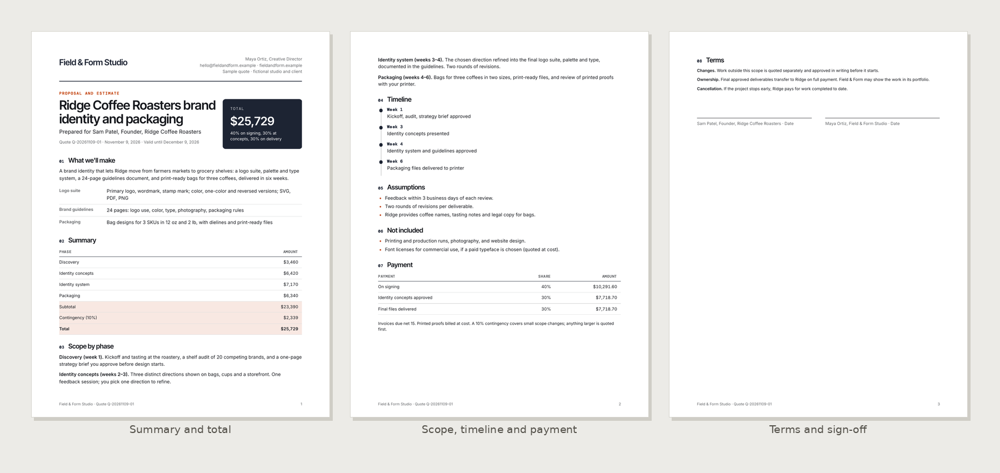
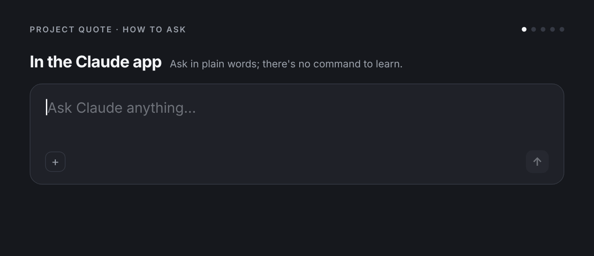

# Project Quote

Turn "here's what the client wants" into a quote a client can sign: what you'll make, in what phases, what it costs and why, when it's paid, what's assumed and what isn't included. The numbers come from a calculator script, never mental math. It also makes a one-page rate card.

**What you get:** Turns a project scope into a branded quote and statement of work PDF (phases, deliverables, hours and rates or fixed fees, contingency, payment schedule, assumptions, out of scope, timeline, terms and a signature block), with totals computed by a script so the math is always right. Also makes a one-page rate card of services and rates.



**See the full sample:** [Sample-Field-and-Form-Quote-Ridge-Coffee.pdf](examples/Sample-Field-and-Form-Quote-Ridge-Coffee.pdf) (fictional names and figures)

Made by Beautiful Engine · [beautifulengine.com](https://www.beautifulengine.com) · [Questions or ideas? Open an issue](https://github.com/BeautifulEngine/project-quote/issues/new)

## Install

### Claude app (web or desktop)

1. Download **[project-quote.zip](project-quote.zip)** from this repo (open the file, then use the download button). Don't unzip it.
2. Turn on **Settings > Capabilities > "Code execution and file creation"**.
3. Go to **Customize > Skills**, click **+**, then **+ Create skill > Upload a skill**, and upload the zip.
4. Start a new chat and ask in plain words. Claude picks the skill up on its own.

> GitHub's green "Code > Download ZIP" button won't work for this; it wraps everything in an extra folder. Use `project-quote.zip`.

### Claude Code

As part of the Beautiful Engine collection (you get updates and the other skills):

```bash
claude plugin marketplace add BeautifulEngine/skills
claude plugin install beautiful-engine@beautiful-engine
```

Then use `/beautiful-engine:project-quote`, or ask in plain words. Or install just this one:

```bash
git clone https://github.com/BeautifulEngine/project-quote.git
mkdir -p ~/.claude/skills && cp -r project-quote/project-quote ~/.claude/skills/
```

Then use `/project-quote`.

## Usage



```
/project-quote <client>: <what they want> [budget] [deadline]
/project-quote rate card
```

Plain requests work too:

- "Quote for a brand identity for a coffee roaster: logo, palette, packaging for 3 SKUs, done in 6 weeks."
- "Estimate a 20×20 trade show booth design and fabrication management for Acme, budget around $60K."
- "Make my rate card: Design Director $175/hr, Designer $120/hr, day rate $1,300."
- "Turn this client email (attached) into an SOW."
- "Same quote, but as fixed fees per phase instead of hours."

## When Claude uses it

Someone asks for a quote, estimate, proposal with pricing, SOW, budget for a creative or freelance project, a rate card, or help pricing a project.

## How it works

```
project-quote/
├── SKILL.md
├── assets/  base.css, deck.css, quote-template.html, ratecard-template.html
├── scripts/  audit.js, contact_sheet.py, fonts.py, quote_calc.py, render.cjs, render.py, tokens.py
├── references/  rendering.md
```

PDFs are built from HTML templates, colored and typeset with the right brand, rendered by headless Chrome, then checked for fonts, text contrast and leftover blanks before delivery. Anything with numbers in it is calculated by a script, not estimated.

## Works well with

- [Activation Concepts](https://github.com/BeautifulEngine/activation-concepts)
- [Build Spec](https://github.com/BeautifulEngine/build-spec)
- [All Beautiful Engine skills](https://github.com/BeautifulEngine/skills)

## Made by Beautiful Engine

Project Quote is made by [Beautiful Engine](https://www.beautifulengine.com), a creative studio in Los Angeles working across brand, experiential and interactive design.

- **Website:** [beautifulengine.com](https://www.beautifulengine.com)
- **Questions, ideas, or something broke?** [Open an issue](https://github.com/BeautifulEngine/project-quote/issues/new) and describe what you asked for and what happened.

This repo is published from [BeautifulEngine/skills](https://github.com/BeautifulEngine/skills); changes are made there and copied here.

## License

MIT. See [LICENSE](LICENSE).

